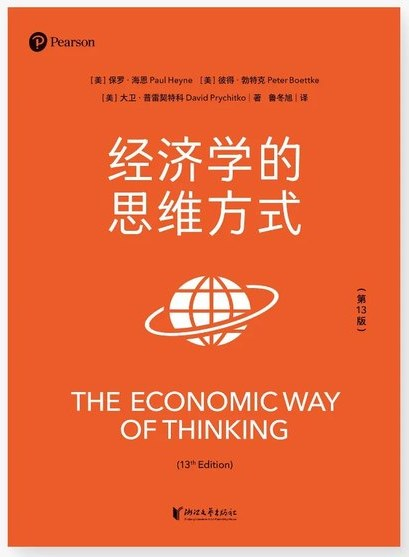

# 《经济学的思维方式》读书笔记

  

> **阅读年份：** 2026 · **笔记：** 51 条 · **整理方式：** 按主题分组，保留原始编号与内容

[← 返回 2026 年阅读书架](../../README.md#2026)

---

## 导读

笔记从个体的选择、稀缺性与合作出发，依次涉及交换和产权、分工与制度演化、机会成本、市场协调，以及货币政策和宏观经济。以下按照概念关联分组，**保留原笔记的先后顺序与基本措辞**；其中的理论判断是阅读记录，并不意味着已对每项观点进行独立论证。

## 一、经济学的视角：选择、合作与知识（1—14）

1. 许多人觉得经济学问题令人困惑，是因为他们对于一个正常运行的经济系统没有清晰的概念。

2. 如果没有促进合作的制度，我们就不能享受文明的种种好处。

3. 个人在信息极其有限的情况下追逐自身利益，不但没有造成混乱，反而形成了井然有序且成果丰硕的社会。

4. 经济学研究人们的选择及其无意的结果——未预期到的副作用。

5. 经济学的思维方式在使用过程中会关注三个方面：第一，行为（actions）；第二，互动（interactions）；第三，结果（consequences），不管这些结果是有意的还是无意的。对行为的关注强调了优化（economizing）和权衡（trade-offs），或者说取舍。

6. 经济学的思维方式会帮助我们认清楚优化过程，即稀缺性约束之下的选择行为。

7. 个体经济行为的核心问题是稀缺性，那么群体互动的核心问题，就是个体计划的多种多样甚至互不兼容。

8. 市场交换经济的基础是私有产权，即法律以所有权的形式把权利指派给特定个体，明确地界定谁在法律上拥有什么。

9. 经济理论如此专注地研究选择，以至于有人曾批评经济学竟然假设人们会选择失业或贫困的生活。

10. 只有个体进行选择，个体在衡量收益和成本后选择。

11. 对任何知识的探索都必然是从求知者一方的某种约定或信念开始的，我们不可能带着一个完全开放的头脑去接触世界，因为我们不是昨天刚刚出生的。不管在什么情况下，完全开放的头脑意味着完全空白的头脑，什么也学不到。

12. 我们首先要知道自己在哪里，然后以我们认为真实、重要、有用或者有启发性的东西为基础向前走。

13. 事实上，我们所“知道”的东西中，只有一小部分是直接观察得来的，东一榔头，西一棒槌。其余部分要靠我们用所持的各式理论补足：狭窄的或宽泛的，模糊的或精确的，经过仔细检验的或未经仔细检验的，普适的或特殊的，经过缜密推理的或只是含混认知的。

14. 经济学的思维方式要补充其他领域的知识：历史、文化、政治、心理学以及塑造人们价值观和行为的社会制度。

## 二、稀缺、交换、财富与产权（15—24）

15. 贸易能增加参与各方的财富，进而是生产性的。

16. 如果某人必须付出代价才能得到一个东西，那它就是稀缺的。

17. 经济增长并不在于生产更多的东西，而在于生产更多的财富。财富的增长和物质产品的体积、重量或数量增长没有必然的联系，我们必须从根本上抛弃“财富等于有形物质”这一见解。

18. **自愿的交换从来就不是等值交换。如果是的话，交换就不会发生了。**

19. 在一个自由达成的交换中，双方都期待通过放弃某种价值较小的东西，来获取某种价值较大的东西。

20. 任何选择都有代价，即机会成本。

21. 若一个计划或者项目的额外收益高于额外成本，那么就被称为是有经济效率的。

22. 关于效率的争论，实际上是关于价值观和产权的争论。

23. 在游戏规则建立起明晰和有保障的产权的同时，它也暗中决定了用什么样的程序来衡量期望的成本和收益，以达到决策目标。

24. 当产权是清晰、稳定而且可交换的时候，稀缺资源会倾向于产生一个能反映其相对稀缺性的货币价格，然后决策者会使用这些价格信息追求（其所认为的）效率。

## 三、专业化、分工与自发秩序（25—34）

25. 人们追求专业化是因为这样做能增加他们的财富。

26. 在自由市场的进程中，供求创造了价格，而价格作为一种“信息”，可以让人们评估不同商品和服务的稀缺程度、更好地协调人们的生产和消费计划。

27. 无论你相信与否，纵观人类历史，除了极少数享有特权的人以外，贫穷几乎一直是人类社会的规律，而不是例外。

28. 财富来自分工引起的产量大幅增加。

29. 抽象的“国家”本身若想“采用”诸如商业社会这么复杂的体系，并不是其想采用就能真正达成的，甚至对个人来说也是如此。

30. 引出上述许多利益的分工，原不是人类智慧的结果，尽管人类智慧预见到分工会产生普遍富裕并想利用它来实现普遍富裕。分工的发展是缓慢的、渐进的，没有人设计这个历史演进的过程，甚至没有人想过要设计它。

31. 复杂的社会制度演变：没有预先蓝图。

32. 国家现行的体制往往源于偶然的发现，这当然是人类行为的结果，但并非任何人类设计的执行；人类社会常常经历“最伟大的变革，而这些变革的本意往往并非求变”；甚至政府官员也“并不总是知道，他们的计划会把国家引向何方”。

33. 从最卑下的野蛮行为演变到最高级的富裕状态，并不需要什么特别的条件，只要和平、税赋较轻、政府有相当的公义即可，其余的事都由事物的自然过程产生。

34. 如果我们在看过历史之后问现在应该做些什么，那么有一件事至少是明确的，就是政府必须建立法治社会，使其治下的人们有望得到他们的投资和努力的收益（当然也要付出代价）。没有法治，商业社会无法成功发展。

## 四、边际选择、机会成本与沉没成本（35—40）

35. 所有的稀缺品都有替代品。选择都是在边际上做出的。

36. “事物”不会有成本。只有行为（或决策）才有成本。

37. 不存在“客观”的成本。所有成本都是对某人而言的成本，此人要对被放弃的机会赋予价值。

38. 沉没成本是与经济决策无关的。过去了就是过去了。决策过程中唯一重要的成本是边际成本，即额外的成本，而且边际成本都是将来的事。

39. 教训本身当然不能说是不相关的，只是这项成本已经与现在无关了。问题是，你现在该干什么？

40. 所有机会成本都是边际成本，而所有边际成本也都是机会成本。机会成本和边际成本是一回事，只不过看问题的角度不一样罢了。机会成本关注的是一项行为所放弃的机会的价值，而边际成本关注的是一项行为会使现在的境况发生怎样的变化。和决策有关的任何成本，全名就是边际机会成本。

## 五、市场过程、价格与竞争（41—47）

41. 对每个人来说，知识和信息都是稀缺品。

42. 市场是买卖双方计划协调（plan coordination）的过程。当经济学家使用供给和需求这样的术语时，他们其实是在讨论人与人之间这种持续进行的谈判（negotiation）。

43. 任何商品或服务的自由市场都有出清的倾向。

44. 人们的信息和知识是有限的，这一点无法避免，人们通过竞价和合作性的交换来追逐各自的目标和计划，市场出清只不过是这些活动的无意后果。

45. 毒品的问题反映的并非市场规律的失灵，相反即使在非法领域，市场机制仍然惊人的稳健；这其实是政府的失灵，是政府未能有效推行它的游戏规则。

46. 那么觅价者如何找到他们所要寻找的价格呢？通过：①估算边际成本和边际收益；②确定产出水平，以便能刚好卖掉使边际收益大于边际成本那么多的产品；③制定价格或一组价格（差别定价时），以便能刚好卖完产出。

47. 但是不论这在特定案例中是否是长期效果，重要的是，在评估政府的竞争政策时，一定要知道下面这条原则：限制竞争者的法律会限制竞争。要为此类法律寻求正当性，一条非常普遍的理由是：它们通过限制“掠夺性”竞争者保护了竞争。

## 六、GDP、货币政策与宏观经济（48—51）

48. 实际GDP以恒定购买力的货币价格衡量一个国家的总产出或总收入。名义GDP，或当前货币价格下的GDP，被实际GDP相除可以得到GDP平减指数，用来衡量通货膨胀或者变化的货币价值。

49. 经济大萧条后的很多年里，经济学家当中的一个压倒性观点似乎是：虽然货币政策在防止通货膨胀方面可能有效果，但在对抗经济衰退上大多是无效的。当时人们喜欢用绳子上的气球来做比喻：你可以靠拉绳子阻止气球上升，但是你不能靠推绳子让气球上升。

50. 当期望利润和亏损错误的货币计算十分普遍，以至于在整个经济系统中表现为错误集群，可能的罪魁祸首便是通过扩大货币供给人为地降低利率。暂时的廉价信贷在商业周期中制造出的“繁荣”阶段无法长期持续，当意料之外的亏损变为现实时，计划会随之相应调整，最终导致经济的衰退和下行。在这种情况下，萧条能够对之前所犯错误和资源的错误分配进行纠正。如果美联储实施均衡的货币政策，努力使经济系统中的货币供给量和需求量相等，这种普遍的错误计算和其所体现的错误集群就能被最小化。稳定性的货币政策通过调整货币供给量适应公众对货币需求的变化。

51. 政府少做点，反而可能是对维护经济稳定的最大贡献。更加稳定、更加有预见性的政府政策，给经济系统带来的不确定性会更少。

---

[← 返回 2026 年阅读书架](../../README.md#2026)
